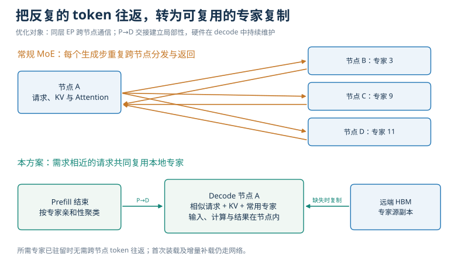
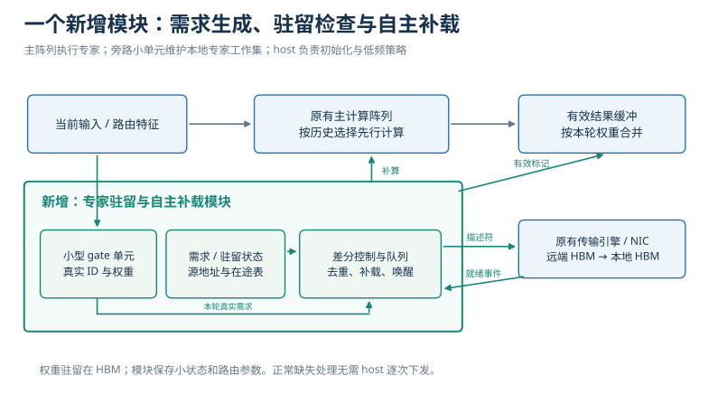
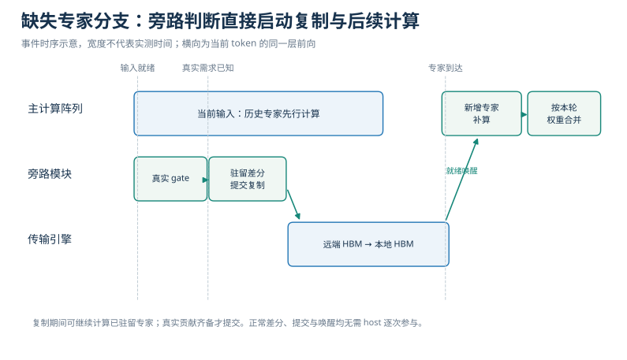
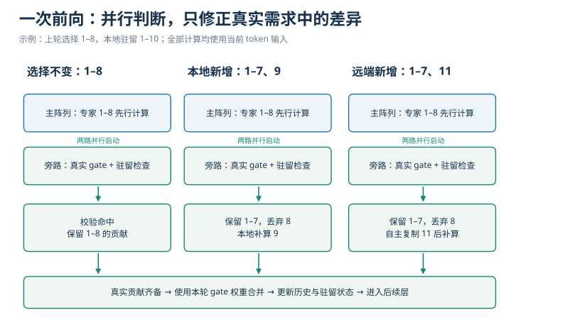
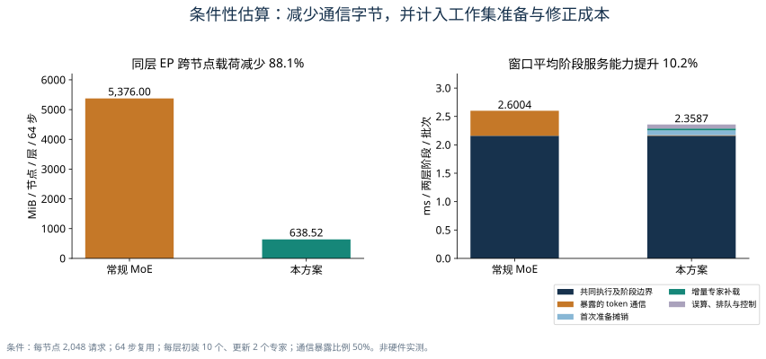

# 面向服务器 MoE 解码的专家驻留与自主补载加速模块、执行方法及芯片

**专利技术方案提案｜2026 年 10 月 13 日**

## 摘要

**问题与成因。** 大规模混合专家模型（MoE）推理中，同一层的专家分散在多个服务器节点，当前节点内请求所需的专家可能位于不同远端节点。每生成一个 token，系统都需要跨节点分发输入、收回专家结果，形成反复的 All-to-All 通信。节点内高速互连与跨节点网络的带宽和同步成本存在差异，这些往返会限制 decode 吞吐。

**核心构思与依据。** 本项目模型具有同一请求、同一层专家激活稳定连续的特点。Prefill 结束后，按每条请求的分层专家需求聚类，将需求相近的请求及 KV 状态交接到同一 decode 节点，并准备对应专家。已有 Top-1 实验中，保留 4 个专家后每百次访问仅需加载 1.16–1.42 次，为少量专家持续复用提供依据。这使反复跨节点发送 token 的问题，收敛为**节点内请求需求与专家驻留的动态匹配**：初始聚类与专家准备建立本地执行条件，后续仍需随真实需求变化检查并补齐专家，才能持续保持节点内执行。

**专利方案。** 针对上述动态匹配，在 GPU 或神经网络加速器内增加一个**专家驻留与自主补载模块**，将本轮需求判断、驻留检查和缺失补载连接为设备内自主执行过程。模块由需求与位置存储、小型 gate 计算单元、差分控制与传输提交逻辑组成。GPU 主阵列可按上一步选择先行计算当前输入，旁路 gate 单元同步生成本轮真实需求。模块检查驻留状态，缺失时直接从其他节点或卡的 HBM 复制专家，到达后触发关联计算；正常需求检查、补载提交和就绪唤醒无需 host 逐次参与。最终按本轮真实选择及权重提交结果。

**预期效果。** 完整软硬结合方案以少量可复用的专家复制替代反复的跨节点 token 往返，同时省去缺失处理中的 host 调度环节。以四节点构成一个两层流水线阶段、每节点每批 2,048 条请求、Top-8、64 步复用窗口为代表性条件，分析估算得到：

| 指标 | 常规 MoE | 本方案 | 预计改善 |
|---|---:|---:|---:|
| 单节点、单层、64 步的 EP 跨节点载荷 | 5,376.00 MiB | 638.52 MiB | 减少 **88.1%** |
| 两层阶段平均服务时间，含准备摊销与阶段边界 | 2.6004 ms | 2.3587 ms | 减少 **9.3%** |
| 同批量下的窗口平均阶段服务能力 | 1.00× | 1.102× | 提升 **10.2%** |
| 工作集已建立后的阶段服务能力 | 1.00× | 1.143× | 提升 **14.3%** |

中心配置为每卡约 8 MiB 新增片上存储预算、小型独立路由算力，以及每节点两层约 0.985 GiB 的专家副本与更新空间。以上为公开实测量级校准的条件性分析估算，已计入首次准备、增量复制、推测误算和控制成本；Top-k 分组覆盖率及新模块性能是目标实施参数，尚非新芯片实测结果。流水线吞吐的成立条件和端到端换算见第 5 节。

---

## 1. 问题动机

### 1.1 目标场景与部署抽象

本方案面向大规模 MoE 的高并发服务器 decode，直接优化同层专家并行（EP）中的跨节点通信。每个节点承担一层或少数完整层的前向阶段；同层专家池由该阶段的多个节点共同承载。Attention 与本地请求 KV 位于请求归属节点，专家权重在集群 HBM 中至少保留一个可服务源副本。

| 对象或并行方式 | 部署方式 | 本方案的处理 |
|---|---|---|
| 请求、attention 与 KV | 请求在各节点间分配，本地执行 attention | P→D 交接时加入专家亲和性，decode 期间保持请求归属稳定 |
| 同层专家 EP | 本层完整专家池分布在若干节点 | 按持续需求增加有限本地副本，减少远程 token 执行 |
| 节点内 TP | 专家或 attention 可在本节点多卡间切分 | 抽象为节点有效算力、容量与内部通信；目录记录分片地址 |
| 流水线 PP | 不同节点组承担不同层段 | 各阶段独立维护工作集；阶段边界通信和瓶颈仍计入性能 |
| 控制状态 | 各请求、各本地层分别保存 | 所有负责层均可活跃，不依赖“仅当前层活跃”的假设 |

代表性阶段由 4 个节点、每节点 8 张卡组成，负责 2 个 MoE 层；每层 128 个专家，初始各节点保存 32 个。上述数量用于实施与估算，不限定权利要求。专家分布由并行服务和容量预算共同决定，不要求声称单层参数在物理上绝对无法装入一个节点。

### 1.2 挑战来自反复的跨节点输入分发与结果返回

一层通常经历 attention、gate、dispatch、expert、combine。Attention 产生的当前输入位于请求节点，而选中的多个专家可能分布于节点 B、C、D；系统将输入分别发往目标节点，专家计算后再返回结果。不同请求同时执行这一过程，形成 All-to-All 通信。

下一 token 需要新的输入和新的计算结果，即使专家选择不变，也会重复通信。提前知道目的地只能帮助调度；把常用专家保留在请求身边，才能减少这些反复传输。

DeepSeek 的公开系统资料采用跨节点专家并行及通信计算重叠；DeepEP 的 H800 normal-kernel 实测中，节点内 dispatch/combine 带宽为 153/158 GB/s，EP16 跨节点为 43/43 GB/s。其 low-latency decode 测试也直接报告了 dispatch/combine 时延，说明实际收益应以部署中仍暴露的通信为准。[部署说明](https://github.com/deepseek-ai/open-infra-index/blob/main/202502OpenSourceWeek/day_6_one_more_thing_deepseekV3R1_inference_system_overview.md)、[DeepEP 实测表](https://github.com/deepseek-ai/DeepEP/blob/v1.2.1/README.md#performance)。

### 1.3 算法先验：少量专家可持续服务后续 token

专家连续性使单条请求的需求长期集中在较小集合，硬件因而可以保留比瞬时 Top-k 略大的工作集。请求从 A 切到 B、再回到 A，只要 A、B 都已驻留，就不需要再次搬运权重。**决定补载量的是工作集缺失，不是专家 ID 的切换次数。**

本项目现有约 0.966B、1.917B 模型均使用每层 8 个路由专家、Top-1 激活。64 条、每条 2,048 tokens 的轨迹统计如下；加载次数包含冷启动，采用 LRU 替换。

| 模型与路由 | 相邻 token 专家切换率 | 1 槽加载次数/100 次访问 | 2 槽 | 4 槽 |
|---|---:|---:|---:|---:|
| M，常规路由 | 80.16% | 80.17 | 65.63 | 39.94 |
| M，本项目连续路由 | **5.48%** | **5.53** | **2.79** | **1.16** |
| L，常规路由 | 80.07% | 80.08 | 65.48 | 39.98 |
| L，本项目连续路由 | **6.40%** | **6.45** | **3.27** | **1.42** |

证据来源：[项目多尺度验证报告，第 4.4 节](../docs/moe_0814.md)。这里说明算法对硬件提供的能力，不展开路由算法内部推导。

Top-k 扩展使用同一集合接口：本轮选中集合包含于本地驻留集合，就可本地完成。例如，Top-8 请求组可在 10 个常用成员中选择不同组合。请求无需完全相同的 Top-k；聚类按需求重叠和新增驻留成本组织。大批量提供更多可匹配请求，实际组内覆盖率、跨层综合匹配效果及持续窗口由大专家池轨迹标定。

### 1.4 Prefill 后聚类，建立请求需求与专家驻留的初始匹配

本方案在既有 P→D 交接中增加专家亲和性这一选择因素：

1. 提取每条请求在 prefill 尾部的分层专家集合及频率摘要。
2. 按专家需求相似度聚类，在 KV 容量、计算负载允许的节点中选择目的地。
3. 将请求及对应 KV 状态交接到 decode 节点，同时准备其常用专家。
4. Decode 期间由真实 gate 持续校正工作集；额外槽位吸收成员切换，超出覆盖时增量补载。

不同层使用各自的专家集合，不要求跨层激活一致。PP 部署中，交接确定各阶段的请求归属和对应 KV 分片，阶段之间按固定请求映射推进。首个 decode 步仍按真实路由校验，prefill 摘要用于初始驻留和预测。

既有 PD 分离系统已经具有 KV 交接和 decode worker 选择机制；专家摘要和匹配是本方案新增的小状态及控制工作。在交接布局、路径相当时，无需再额外复制一遍完整 KV，但摘要、分组和专家准备仍计入预算。[Dynamo 架构说明](https://docs.nvidia.com/dynamo/dev/knowledge-base/concepts/system-architecture/disaggregated-serving)。

### 1.5 核心问题的收敛：节点内请求需求与专家驻留的动态匹配

Prefill 后的分组与专家准备建立了初始匹配，但 decode 期间的真实专家选择仍可能变化，动态批次中的请求也会进入或退出。要持续减少跨节点 token 往返，就必须及时确认本轮所需专家是否在本节点可用，并在缺失时完成增量补载与关联计算。

专家连续性使这一维护过程具有较小、可复用的工作集：已覆盖的需求直接本地执行，新增需求只补齐缺失成员。由此，原先每步面向远端专家分发 token 的通信挑战，收敛为**如何高效维持节点内请求需求与专家驻留的动态匹配**。

本专利聚焦这一具体环节：用加速器内的小型模块，在前向计算同时生成真实需求、检查驻留差分，并自主完成缺失专家复制和到达后的任务唤醒，免去 host 逐次判断与提交。聚类提供本地执行机会，模块负责在需求变化时高效维持这一条件。

---

## 2. 现有方案及其痛点

### 2.1 常规专家并行：每步把 token 送到专家

固定专家放置具有清晰的容量和计算分工，适合作为本提案的整体对照。其成本在于数据所在节点与专家所在节点不一致时，每次访问都承担跨节点 dispatch/combine。对持续需要相近专家的请求，这部分通信会随生成长度累积。

本方案将聚类后持续出现的专家需求转化为本地副本；计算的专家和本轮路由权重仍由模型确定，节省来自执行位置及传输频率的改变。

### 2.2 优化通信库与重叠：降低单次成本，仍需搬运数据

DeepEP 等系统通过融合、低时延通信和与计算重叠减少通信暴露时间；它们应保留在基线中。已被计算覆盖的网络时间不能再次算作本方案的收益。第 5 节将两侧 token 通信暴露比例统一设为 50%，并扫描不同暴露程度。

同一目标节点内的多个专家可共享输入并局部合并结果，流量按远程目标节点数计费，避免按 Top-k 重复放大基线。公开实现已存在同一 rank 的输入去重；本文节点级去重作为两侧一致的建模条件。[TensorRT-LLM 通信说明](https://nvidia.github.io/TensorRT-LLM/1.3.0rc14/blogs/tech_blog/blog18_Optimizing_MoE_Communication_with_One_Sided_AlltoAll_Over_NVLink.html)。

### 2.3 专家放置与预测缓存：提供系统基础，需要具体硬件执行连接

在线专家放置、预测预取和相似路由请求调度已有研究。Director 使用预测驱动的在线专家放置与迁移；ExpertFlow 将路由预测、专家缓存和相似路径 token 调度结合。它们说明专家复用和组织请求具有实现基础，也要求本提案把创新落到专用模块的具体连接关系。[Director](https://arxiv.org/abs/2607.08782)、[ExpertFlow 作者实现](https://github.com/expertflow-dac/expertflow)。

初始放置完成后，持续 decode 仍需维持节点内请求需求与专家驻留的动态匹配。当缺失管理由 host 驱动时，需要收集需求、查找源副本、预留空间、提交搬运，再安排后续任务。本模块把真实需求判断与这些正常路径动作直接连接，在 GPU 内完成匹配检查和增量补载，同时维持逐请求的正确结果状态。

### 2.4 GPU 自主通信已有基础，新增的是专家语义闭环

GPUDirect RDMA 支持设备显存直达；NCCL 已提供设备侧通信 API，GIN 还区分 CPU proxy 与 GDAKI 后端。因此，通用“GPU 发起网络传输”本身已有基础。本方案明确要求常规提交和进度推进使用设备自主路径，将真实专家需求、驻留差分、源地址和计算就绪事件直接连接起来。[GPUDirect RDMA](https://docs.nvidia.com/cuda/gpudirect-rdma/)、[NCCL Device-Initiated Communication](https://docs.nvidia.com/deeplearning/nccl/user-guide/docs/usage/deviceapi.html)。

> 本提案的硬件问题：如何用加速器内的一个小型模块，高效维持节点内请求需求与专家驻留的动态匹配，在前向过程中自主判断需求、检测缺失、复制远端专家并触发到达后执行，免去 host 逐次调度，使专家连续性带来的本地执行机会持续成立，从而减少反复的跨节点 All-to-All。

---

## 3. 方案详情

### 3.1 总体架构

新增模块负责节点内请求需求与专家驻留的动态匹配，位于 GPU 内部、主计算阵列旁路。专家权重继续保存在各卡 HBM；传输由既有卡间互连及网络引擎执行。模块只增加需求存储、轻量路由计算和控制，不增加第二套专家矩阵阵列。

装置包含以下已有单元与新增部分：

| 单元 | 属性 | 作用 |
|---|---|---|
| 主计算阵列 | 已有 | Attention、当前输入的专家计算、聚合等 |
| 本地 HBM 与节点内互连 | 已有 | 保存基础权重、工作集副本、KV 与中间结果；执行节点内分发 |
| 卡间/网络传输引擎 | 已有 | 将远端 HBM 副本复制至已注册本地地址 |
| 专家驻留与自主补载模块 | **新增** | 独立生成需求、检查驻留、合并缺失、提交复制、到达唤醒与结果校验 |

### 3.2 小存储：按请求和层保存需求，按专家保存位置

模块的状态分别服务请求正确性和副本复用：

| 状态 | 关键字段 | 粒度与用途 |
|---|---|---|
| 请求需求表 | 请求 ID、层号、生成步、历史/本轮专家位图 | 所有本地负责层分别维护；动态 batch 不依赖行号索引 |
| 结果状态 | 本轮 gate 权重、已完成贡献、有效标记 | 防止误选结果进入下一层，支持延迟合并 |
| 驻留目录 | 专家 ID、节点内卡/分片、地址、版本、引用 | 判断本节点可执行性，保护正在使用的权重 |
| 源副本表 | 远端节点/卡、地址、长度、访问凭据句柄 | 选择在线源副本，填入传输描述符 |
| 在途与等待表 | 缺失专家、目标槽位、等待请求、完成事件 | 多个请求共享一次复制，到达后唤醒 |

128 个专家的集合仅需 16 字节。所有本地层均保有独立状态；完整上下文可放在 HBM，片上容量根据并发请求与层数配置。专家权重不放在这块小存储中。

### 3.3 小型 gate 单元：与专家主阵列并行生成真实需求

gate 单元执行模型规定的路由输入处理、投影、打分、Top-k 和归一化，输出真实专家 ID 与本轮组合权重。采用独立算力与调度，主阵列执行专家时仍能推进路由。

路由输入与专家输入使用模型各自规定的表征。实施接口可以直接接收已准备好的路由摘要；摘要形成的存储和时间属于正常路由前处理预算。该单元不通过近似选择改变模型本轮计算语义，也不要求对外展开亲和性算法内部机制。

单卡按请求子批处理，跨卡仅交换必要需求摘要。节点内可指定一个目录所有者，统一处理同一专家的复制与槽位预留，避免多卡同时重复装载；这一控制不依赖 CPU 逐次参与。

### 3.4 差分控制：区分补算与补载

设历史选择为 $P$，本轮真实选择为 $A$，本节点可服务专家为 $S$。主阵列对 $P\cap S$ 使用当前 token 输入先行计算，旁路单元产生 $A$ 后执行：

| 条件 | 动作 |
|---|---|
| $A\cap P\cap S$ | 保留这些专家对当前输入的计算结果 |
| $(A\cap S)\setminus P$ | 本地已有新选中专家，直接安排补算 |
| $A\setminus S$ | 权重缺失，合并相同需求并自主复制，再执行计算 |
| $(P\cap S)\setminus A$ | 取消可取消部分，丢弃已产生的未选中结果 |

**补算**是补齐本轮真实需要、推测任务尚未覆盖的贡献；**补载**是把本节点尚无有效副本的权重复制进来。集合变化可以只引发补算，无需传权重。

组内专家需求用位图并集归约，去重补载；结果选择始终保留逐请求粒度。即使 ID 完全相同，最终也采用本轮 gate 权重。所有真实贡献齐备且通过有效性校验后，输出才进入下一层。

### 3.5 自主传输与软件可见接口

host 在初始化和低频资源调整时配置策略，正常缺失由模块完成。建议提供以下接口，名称仅表示功能：

| 接口 | 方向 | 内容 |
|---|---|---|
| 注册源目录与内存 | 软件 → 模块/传输引擎 | 模型版本、层/专家映射、已注册源地址与目标池 |
| 配置驻留预算 | 软件 → 模块 | 常用槽数、暂存槽数、复制阈值和回退策略 |
| 建立/释放请求上下文 | 调度器 → 模块 | 请求 ID、P 阶段摘要、KV/阶段归属、生命周期 |
| 提交当前层输入 | 执行器 → 主阵列与模块 | 当前输入、路由表征、层号及生成步 |
| 复制专家 | 模块 → 传输引擎 | 源/目标地址、字节数、版本、完成事件 |
| 查询状态/读取计数器 | 模块 → 软件 | 命中、补载字节、等待时间、推测有效率 |

缺失状态依次为“预留 → 传输中 → 可用”。传输完成后确认内存可见性，再发布驻留映射并唤醒计算。源副本在复制期间保持有效；目标槽位在旧计算引用结束后回收。首步缺少历史时使用真实 gate；偶发需求或容量不足时可沿已有远程 token 路径执行。异常恢复可以交给 host，常规需求处理不需 host 介入。

### 3.6 物理实施形态

| 形态 | 新增结构位置 | 适用方式 |
|---|---|---|
| A：GPU 内独立模块 | 片上 SRAM、小矩阵/向量单元、控制状态机，与本地计算及传输队列连接 | **主实施方式**；路由和控制具有独立执行资源 |
| B：NPU 内专用控制核 | 小型数字运算单元与微码控制核，复用片上互连 | 适合自研神经网络加速器，保持相同事件接口 |
| C：同封装控制 chiplet | 靠近计算 die 的路由与状态模块，通过片内链路连接 | 面向模块化实现；需把跨 die 输入及事件延迟计入预算 |

节点内多卡由设备侧目录协调；跨节点复制使用已注册 HBM 地址。存储介质和网络协议沿用目标平台，专利重点是模块内部状态与执行事件的连接。

### 3.7 硬件执行流程

1. P→D 交接建立请求组及初始驻留集合。
2. 当前层输入就绪，历史选择启动主阵列任务，小型 gate 单元同步计算真实需求。
3. 模块比较真实选择、历史任务及本地驻留状态。
4. 已驻留贡献在节点内计算；缺失成员归并后查表，提交远端 HBM 复制。
5. 副本到达、版本和可见性确认后，模块唤醒关联任务。
6. 按本轮真实权重合并有效贡献，更新历史与驻留状态。

同一专家只要持续服务当前请求组，就跨生成步保留；不会因为 Top-k 组合变化而无条件重新复制。

---

## 4. 实施例：一个 Token 的四阶段前向过程

准备阶段：Prefill 尾部摘要显示一组请求在某层主要需要专家 1–10，因此将请求与 KV 交接到节点 A，准备这 10 个专家。本例一条请求上轮选中 1–8；全部推测任务都处理当前 token 的新输入。

| 阶段 | 主要动作 | 大数据流向 | 小状态流向 |
|---|---|---|---|
| 1. Attention 与输入准备 | 读取本地 KV，生成专家输入和路由表征 | KV、attention 权重在本节点读取；新增 KV 写回 | 请求 ID、层号、生成步及摘要进入执行接口 |
| 2. 并行路由与驻留判断 | 主阵列计算历史专家，旁路产生真实 gate | 当前输入在节点内送往已驻留专家 | ID、组合权重与驻留位图进入差分逻辑 |
| 3. 专家执行与缺失修正 | 保留命中贡献；新增本地专家补算；缺失权重复制后计算 | 正常输入/输出在节点内；缺失专家从远端 HBM 复制 | 描述符、在途状态、完成事件及等待者登记 |
| 4. 有效提交与下一层 | 按真实权重合并，保持副本，推进后续层 | 结果进入本地下一层或按 PP 映射跨阶段发送 | 更新历史、释放引用、维护驻留版本 |

### 4.1 阶段一：Attention 与 KV 更新

本节点完成对应层的 attention，生成当前专家输入和模型规定的路由表征。路由前处理计入该阶段的执行预算。不同本地层、不同流水批次可同时活跃，输入和状态都带有独立标识。

### 4.2 阶段二：真实 gate 与先行专家计算

主阵列在专家 1–8 上执行当前输入；小型 gate 单元并行计算本轮专家 ID 与权重。结果缓冲暂存尚未校验的专家输出。独立执行资源允许两条路径并行，但共享 HBM 和互连的实际影响仍进入时间预算。

### 4.3 阶段三：三种需求分支

- **本轮仍为 1–8：** 结果全部有效，等待本轮组合权重后合并。
- **本轮为 1–7、9：** 保留 1–7，丢弃 8，直接补算本地专家 9；无专家跨节点传输。
- **本轮为 1–7、11：** 模块找到远端专家 11，自主预留槽位并提交复制。1–7 可继续执行，11 到达后补算；组内多个请求共享该副本。

这三个分支分别对应持续命中、工作集内切换、工作集增量更新。模块重点处理第三种情况的自动化，使一次复制能够承接后续多次访问。

### 4.4 阶段四：正确提交并保持工作集

本轮选中专家的贡献齐备后，使用本轮 gate 权重完成合并。推测未选中的贡献不发布，下一层不读取未校验结果。更新请求历史并保留常用专家，下一生成步重复执行。

PP 阶段之间仍传送层输出；本方案减少的是同层 EP 分发及返回，不删除模型正常的阶段边界通信。

---

## 5. 理论性能、容量与硬件代价估算

### 5.1 对照口径与公开依据

比较对象为**常规 MoE 的固定专家分布、逐步 token 分发**与**连续专家需求、P→D 分组、本地驻留及自主补载的完整方案**。节点、GPU、矩阵尺寸、Top-k、精度、并发与链路条件保持一致，基线保留目标节点去重和通信计算重叠。本方案额外计入副本空间、路由模块、复制、误算及调度成本。质量可比是模型部署条件，现有小模型证据与大模型实施假设分开列示。

参考配置使用公开模型矩阵尺寸、DeepEP 的实测带宽量级及 DeepSeek 的公开 decode 轨迹，不以厂商峰值 FLOPS 代替有效执行速度。

| 来源 | 本文用途 | 使用范围 |
|---|---|---|
| [DeepSeek-V3 配置](https://huggingface.co/deepseek-ai/DeepSeek-V3/blob/main/config.json) | 隐藏维度 7,168、专家中间维度 2,048、Top-8、128×128 FP8 块；MLA KV 维度 | 专家池取 128 是本文实施例，公开原模型为 256 |
| [DeepEP v1.2.1 实测表](https://github.com/deepseek-ai/DeepEP/blob/v1.2.1/README.md#performance) | 单卡链路 43 GB/s 的建模量级 | 来自 EP 通信实测；权重流实际有效带宽需另标定 |
| [DeepSeek profile-data](https://github.com/deepseek-ai/profile-data) | 两个 grouped FP8 GEMM 中位数 79/39 μs | 原轨迹为 EP128、TP1、每卡 128 请求、4K 上下文、均衡路由及双微批；本文按工作量外推 |
| [项目验证报告](../docs/moe_0814.md) | 连续性与有限驻留槽的加载频率 | Top-1 证据，不等同 Top-8 节点工作集实测 |

本次复核 `decode.json` 两类 `GemmType=2` 事件，各 118 次，中位数分别为 79、39 μs；文件 SHA-256 为 `6dd02bfb01ac2e0881f77003f8d8b20420c48d769df863e709623654e9ebfb62`。[原始轨迹](https://github.com/deepseek-ai/profile-data/blob/main/decode.json)。原始测量用于量级校准，跨形状、不同专家负载分布的执行效率属于估算条件。

### 5.2 代表性工作点：一个两层流水线阶段

所有容量和服务时间先按同一个两层阶段核算，再按实际 PP 部署组合。

| 参数 | 中心取值 | 性质 |
|---|---:|---|
| 阶段节点数 / 每节点 GPU | 4 / 8 | 实施例 |
| 每节点负责层数 $L_s$ | 2 | 同一阶段各节点承担这两层的请求及部分专家 |
| 专家池 / Top-k | 128 / 8 | 大专家池目标配置 |
| 每节点每个服务批次请求 $B$ | 2,048 | 每 GPU 256 条；阶段每批共 8,192 条 |
| 观察与更新周期 $H$ | 64 步 | 连续复用条件 |
| 每层初始复制 / 每周期新增复制 | 10 / 2 个专家 | 与切换次数分别设置；初始全部按远端复制计费 |
| 本节点常用副本 / 更新槽预算 | 10 / 2 个专家，每层 | 节点级集合；多卡共享，非每卡各复制 10 个 |
| 基线 / 本方案平均远程目标节点数 | $r_b=2.0$ / $r_p=0.05$ | 分组与覆盖假设，不是单请求命中概率 |
| 节点有效带宽 / 单卡有效带宽 | 200 GB/s / 43 GB/s | 前者为聚合假设，后者取公开实测量级 |
| 两侧 token 通信暴露比例 $\rho$ | 50% | 另外 50% 已被计算覆盖 |
| 正常计算和节点内执行 $T_c$ | 1.900 ms/阶段批次 | 含专家 GEMM、attention、共同本地通信；不含下列 gate 与阶段边界 |
| Gate 预算 $g$ | 50 μs/层，两侧均完整计费 | 新硬件工程目标；不额外扣除其并行收益 |
| PP 边界及固定阶段衔接 $T_{pp}$ | 0.160 ms/批次 | 两侧相同，含本批输出跨阶段传送预算 |
| 初次摘要分组预算 $T_g$ | 1 ms/阶段请求批 | 在窗口内摊销，不是每 token 重做聚类 |
| 额外推测计算比例 $\epsilon$ | 正常专家 GEMM 的 5% | 目标假设；单独扫描 |
| 设备控制 / 修正排队与碎片化 | 2 μs/层 / 20 μs/阶段批次 | 均按额外暴露成本计入 |

本例以网络容量固定且无额外拥塞排队的目标部署建模；聚类后的计算负载通过本地副本或节点内 TP 保持均衡。$r_p$、复制次数和 10 槽覆盖是一组联合实施条件，不能由大 batch 自动推得。同节点在途批次需落入同一工作集预算；若不同请求组交替导致额外替换，应将其复制量一并计入 $u$，不能只统计单条请求。

### 5.3 有效字节模型：反复 token 往返与专家复制

隐藏维度 $d=7168$，中间维度 $m=2048$。单个 FP8 专家由三组矩阵组成，并为每个 128×128 块计一个 FP32 scale：

$$
S_e=3dm+3(d/128)(m/128)\times4
=44,050,944\ \mathrm B=42.0103\ \mathrm{MiB}.
$$

输入采用 FP8、返回采用 BF16，一个远程目标节点的往返载荷为 $v=d(1+2)=21,504$ B。单节点、单层、$H$ 步的专家服务载荷为：

$$
V_b=HBvr_b,\qquad V_p=(K_0+u)S_e+HBvr_p.
$$

| 每节点、每层、64 步 | MiB |
|---|---:|
| 基线 token 分发与结果返回 | 5,376.00 |
| 本方案初次与增量专家复制 | 504.12 |
| 本方案剩余 token 往返 | 134.40 |
| 本方案合计 | **638.52** |
| EP 载荷减少 | **88.12%** |

这里统计有效数据载荷；协议包头、输入量化元数据与控制消息由有效带宽及控制预算吸收。输入和结果按一次网络传输计费，不把发送与接收重复计入集群总量。同一目的节点内的多专家输入去重及局部结果合并已保留。副本复制后，节点内数据流仍存在，其时间纳入 $T_c$。

PP 边界另计：若每批每节点输出 $B\times d\times2$ 字节，64 步为 1,792 MiB。加入两层 EP 和一次阶段边界后，该统计口径的跨节点载荷由 **12,544.00 MiB 降至 3,069.05 MiB，减少 75.5%**。P→D 的共同 KV 交接不属于这段 decode EP 流量；一次性额外分组成本在时间模型中单列。

字节盈亏边界为：

$$
HBv(r_b-r_p)>(K_0+u)S_e.
$$

按中心参数，约超过 6.16 步即可节省字节；时间收益还取决于带宽、已有重叠和执行成本，不能只看字节量。

### 5.4 阶段服务时间：所有新增工作均计入

公开轨迹的两次 GEMM 合计为 118 μs。在均衡 EP128、双微批和 Top-8 条件下，每次约为 512 个 token-expert 计算；本例每卡每层为 $(2048/8)\times8=2048$ 个。因此：

$$
T_e=2\times(2048/512)\times118\ \mu s=0.944\ \mathrm{ms}.
$$

这部分已包含在 $T_c=1.900$ ms 中；其余用于 attention 和正常节点内执行。推测误算另加 $\epsilon T_e$，修正队列和小 GEMM 碎片化另留 20 μs，不把误算当作免费工作。

若 $k$ 个专家尽量均衡复制到 8 张卡，源端也可提供匹配带宽，单层权重复制费用为：

$$
t_w(k)=\max\left(\frac{kS_e}{B_{node}},\frac{\lceil k/8\rceil S_e}{B_{lane}}\right).
$$

中心参数下 $t_w(10)=2.2025$ ms，$t_w(2)=1.0244$ ms。该模型保留节点聚合及最忙卡约束；各层复制按串行累加，不额外扣除其与计算或 KV 交接的重叠。

两侧阶段费用为：

$$
T_b=T_c+L_sg+T_{pp}+\rho\frac{L_sBvr_b}{B_{node}},
$$

$$
T_p=T_c+L_sg+T_{pp}+\rho\frac{L_sBvr_p}{B_{node}}
+\frac{L_st_w(K_0)+T_g}{H}+\frac{L_st_w(u)}{H}
+\epsilon T_e+L_s\tau_c+T_q.
$$

| 每个阶段批次的平均费用 | 常规 MoE | 本方案 |
|---|---:|---:|
| 正常计算与节点内执行 | 1.9000 ms | 1.9000 ms |
| Gate 预算，完整计费 | 0.1000 ms | 0.1000 ms |
| 阶段边界及固定衔接 | 0.1600 ms | 0.1600 ms |
| 暴露的 EP token 通信 | 0.4404 ms | 0.0110 ms |
| 首次专家准备摊销 | — | 0.0688 ms |
| 初次分组摊销 | — | 0.0156 ms |
| 增量专家补载 | — | 0.0320 ms |
| 额外推测计算 | — | 0.0472 ms |
| 设备侧控制 | — | 0.0040 ms |
| 修正排队及碎片化预算 | — | 0.0200 ms |
| **合计** | **2.6004 ms** | **2.3587 ms** |

阶段费用减少 **9.30%**，固定批量的窗口平均服务能力提升 **10.25%**。首次两层专家复制总费用 4.4051 ms，另有 1 ms 分组，在 64 步中完整摊销。工作集已建立后，仍保留同强度增量复制及误算，阶段费用为 **2.2742 ms**，对应服务能力提升 **14.34%**。

本估算不另外给基线添加未经测量的 host 往返罚时，也不把 gate 重叠再次算成收益。Host 路径省去哪些动作由模块结构说明，其具体节省量由缺失发现、描述符提交和就绪唤醒时间戳标定。

实际事件模型还需检查关键路径：驻留全部命中时，gate 与专家执行完成时间取最大值；有差异时，对每个真实贡献记录“路由就绪—差分—必要传输—计算排队—执行完成”，以最后一个有效贡献决定提交。上表采用完整复制与 gate 费用及显式修正预算，不假定差异任务免费并发。

### 5.5 从阶段能力到端到端时延与吞吐

对于流水线，阶段 $j$ 的服务时间为 $T_j$，每批 token 数为 $B_{all}$，其稳态服务上限受最慢阶段约束：

$$
Q\approx\eta\frac{B_{all}}{\max_jT_j},
\qquad
T_{\mathrm{path}}\approx\sum_jT_j+T_{\mathrm{fixed}}+T_{\mathrm{queue}}.
$$

$\eta$ 表示填充、排空和调度利用率。若各瓶颈阶段均采用同类优化、利用率保持相当、请求足以填满流水线，则中心工作点的吞吐改善可接近上述 10.2%；只优化非瓶颈阶段时，主要体现为路径时延下降。

举例：58 个 MoE 层分为 29 个两层阶段，每阶段各自使用四节点资源；dense 层、头尾算子等共同固定路径预算为 3 ms。忽略额外队列变化时，窗口平均 decode 路径预算由 **78.41 ms 降至 71.40 ms，减少 8.9%**。这是按阶段组成的分析示例，MoE 阶段合计使用 116 个节点；dense 层与头尾算子置于这些节点的预留资源中，计入共同固定路径预算。实际部署可换用更少阶段、不同并行配置和测得利用率。

当前参数的阶段批次包含 8,192 条请求。上述大规模流水线需要足够独立请求批次保持并发；不能将阶段服务能力直接作为仅 8,192 条总并发下的整机实测吞吐。阶段映射固定，新增流水线边界开销已经计入两侧 $T_{pp}$。

### 5.6 敏感性：复用窗口、剩余远程需求与通信暴露

中心结论对应高并发、长工作集覆盖窗口和明显通信暴露。以下每行只改变一个参数；窗口扫描保持每个窗口更新 2 个专家，反映不同更新强度。

| 变化参数 | 本方案阶段平均时间 | 相对对应基线服务能力变化 |
|---|---:|---:|
| 复用/更新窗口 16 步 | 2.7081 ms | -4.0% |
| 复用/更新窗口 64 步 | 2.3587 ms | +10.2% |
| 复用/更新窗口 256 步 | 2.2713 ms | +14.5% |
| Token 通信仅暴露 25% | 2.3532 ms | +1.1% |
| Token 通信暴露 100% | 2.3697 ms | +28.3% |
| 剩余远程目标数 $r_p=0.25$ | 2.4027 ms | +8.2% |
| 剩余远程目标数 $r_p=0.50$ | 2.4578 ms | +5.8% |
| 额外推测计算为 20% | 2.5003 ms | +4.0% |

短窗口中复制不一定划算，模块按持续需求预算决定是否装载，偶发需求保留远程路径。分组覆盖率与推测集合重合率分开统计：前者决定网络流量，后者决定额外计算。两者均需用服务器 Top-k 轨迹替换中心假设。

### 5.7 新增容量、路由算力与资源代价

**专家副本。** 10 个常用副本加 2 个更新槽，每节点两层的额外 HBM 为：

$$
C_{rep}=12\times2\times S_e=0.9846\ \mathrm{GiB/节点},
$$

8 卡均摊约 **0.1231 GiB/卡**。已有本地基础专家可以复用，这里按全部额外占用估算。基础副本每层 32 个/节点，两层约 2.626 GiB/节点；KV、attention、共享专家和执行缓冲分别计入，不能把专家副本预算当作全部模型容量。

**小模块存储。** 每卡为所负责两层预留最多 8,192 个请求上下文；它是历史状态容量，不是每批必须同时计算的 token 数。参考划分如下：

| 存储项目 | 计算依据 | 预算 |
|---|---|---:|
| 上轮/本轮位图 | $8192\times2$ 层 $\times2$ 份 $\times16$ B | 0.50 MiB |
| 请求与结果元数据 | $8192\times2\times32$ B | 0.50 MiB |
| 地址表、在途队列、路由得分及余量 | 两层目录与子批缓冲 | 0.25 MiB |
| BF16 gate 权重 | $2\times7168\times128\times2$ B | 3.50 MiB |
| 路由输入双缓冲 | 64-token 子批，$2\times64\times7168\times2$ B | 1.75 MiB |
| 其余队列及实现余量 | ECC、对齐、状态扩展等设计预算 | 1.50 MiB |
| **片上存储配置目标** | | **8.00 MiB/卡** |

推测结果保留在 HBM：64-token 子批、8 个专家、BF16 输出的双缓冲约 **14 MiB/卡**；输入双缓冲约 1.75 MiB。这是同时保留两个子批的执行缓冲预算，增加并发通道时相应扩展。模块的片上缓冲和 HBM 中的执行保留空间分别计费。路由摘要的算法历史放在已有请求状态内；按 16 个 BF16 向量/请求/层的容量上界，8,192 请求、两层约 3.50 GiB/卡，属于本方案显式预留的算法状态，具体实现可压缩。

**独立路由算力。** 线性投影 gate 为 $2dE$ FLOPs/token，Top-k 三矩阵专家为 $6kdm$ FLOPs/token，示例比值约 **0.26%**。这说明路由算力可远小于专家主阵列，但需支持打分、选择、归一化及实际输入读写。

若独立单元的有效投影能力目标为 25 TFLOP/s、输入通路有效带宽为 200 GB/s，则每卡每层 256 请求的投影约 18.8 μs，BF16 路由输入读取约 18.4 μs，再为选择、归一化和状态处理预留 10 μs，取整为 **50 μs/层**的工程预算。这些是新硬件设计目标，不是公开产品的峰值或实测；时间模型已完整计入，原型未达到时应替换 $g$。

**KV 容量检查。** 使用公开配置的 MLA 压缩 KV 维度 $512+64$，BF16、2K 起始上下文、两层及 8,192 个请求上下文时，KV 约 **36 GiB/卡**；再加前述路由历史约 3.5 GiB、专家及其他权重与工作区。实际 HBM 规格应按这些总量和上下文增长留余量，容量不按两层以外的全模型重复计入。

**成本与能耗表达。** 新增成本由片上存储、小算术单元、控制逻辑及接入验证组成；物理面积和功耗需用目标工艺综合，不能由 FLOPs 比例直接代替。固定设备规模下，中心吞吐比为 1.1025：若单设备成本增加比例为 $\delta_C$，单位吞吐成本比例约为 $(1+\delta_C)/1.1025$；成本增幅低于约 10.2% 时，该工作点的单位吞吐成本仍改善。仅作代数示例，成本增幅 2% 对应单位吞吐成本下降约 7.5%，并不表示已取得 2% 的芯片报价。单位 token 能耗可用相同方式结合实测功率比计算。

### 5.8 可实现性与工程边界

组成能力已有实现基础：设备侧网络、显存注册与事件机制支持自主传输，数字小矩阵/向量单元支持 gate，位图和表项支持低开销需求处理。本提案将它们连接到同一个专家驻留闭环。

| 工程验证项 | 需要确认的结果 |
|---|---|
| Top-k 分组与连续性 | 组内工作集覆盖、相邻集合重合、prefill→decode 覆盖曲线；校准 $r_p,u,\epsilon$ |
| 主阵列执行效率 | 聚类后每专家批量、本地 TP/副本负载均衡；校准 $T_c$ 与修正碎片化 |
| 旁路路由与共享访存 | 实际 gate 时间、路由前处理及主阵列带宽竞争；核验 50 μs 预算 |
| 自主补载路径 | 无 host 逐次参与的提交、源副本有效性、可见性与就绪唤醒 |
| 结果正确性 | 对齐真实路由非推测执行；检查 ID、当前输入、权重和版本 |
| 容量与芯片代价 | 全部本地层的状态、KV、权重、缓冲，以及综合面积与动态功耗 |
| 完整服务效果 | 相同资源和质量条件下的平均/分位 TPOT、吞吐及流水线利用率 |

公开测量、实施假设和派生数值在本节分别注明。[计算参数与结果](./analysis/server_moe_residency_results.json)保留完整数值，[敏感性数据](./analysis/server_moe_residency_sensitivity.csv)可用于后续 PPT 图表替换。

---

## 6. 相关专利与非专利现有技术检索

**检索日期：2026 年 10 月 12 日。** 本轮按专家缓存、跨 GPU 专家复制、硬件路由、GPU 自主通信和请求亲和调度检索，并阅读下列公开文本的相关权利要求或技术说明。以下用于技术范围定位，不作为授权结论；正式申请需由代理人继续核验同族、有效权利要求及组合区别。

### 6.1 高相关专利

| 专利与公开文本 | 已公开的相关内容 | 本提案需要明确的区别及核验重点 |
|---|---|---|
| [Intel US20250086424A1：Deployment of resources in mixture of experts processing](https://patents.google.com/patent/US20250086424A1/en) | 权利要求 1、8 涉及路由跟踪、预测和硬件管理；6、13 涉及跨加速器迁移或复制专家 | 与“硬件管理和迁移专家”直接相关；应核验本模块的逐请求/逐层驻留差分、真实 gate、历史执行有效性及到达触发连接，不单靠“硬件复制专家”概括区别 |
| [Intel US20250356164A1：Full and partial hot expert buffers](https://patents.google.com/patent/US20250356164A1/en) | 权利要求 1 涉及完整/部分 hot expert buffer；3、4 涉及异步预取和缺失加载 | 通用缓存命中与加载已有覆盖；本方案具体描述服务器节点内复用、完整专家远端副本、旁路真实需求及任务就绪闭环 |
| [IBM US20250190755A1：Routing acceleration in MoE ensembles](https://patents.google.com/patent/US20250190755A1/en) | 权利要求 1 涉及 MVM tiles、路由向量、Softmax 与最大元素选择；6、7涉及模拟存内计算及数字处理 | 独立路由计算已有相关专利；本方案的路由单元应与驻留检查、复制描述符及正确提交共同限定 |
| [CN120235253A：基于 CPU 和 GPU 协同的混合专家模型推理方法](https://patents.google.com/patent/CN120235253A/zh) | 权利要求 1 涉及缓存状态、异构计算队列与传输重叠；4–6 涉及预取及缓存替换 | 缓存、预取和重叠已有相邻方案；本方案部署于集群 HBM，正常缺失处理在加速器内完成，并保留逐请求真实贡献校验 |

上述文献表明，“专家缓存”“独立 gate”“GPU 间迁移”各自都有公开基础。提案的技术描述应聚焦模块内具体输入、状态和事件连接，保留足够窄且可实施的保护主题。

### 6.2 相关系统与论文

| 文献 | 相关内容 | 与本提案的关系 |
|---|---|---|
| [DeepSeek-V3/R1 系统与 DeepEP](https://github.com/deepseek-ai/DeepEP) | 跨节点 EP、低时延 dispatch/combine、通信计算重叠 | 常规服务器基线及有效性能依据；基线已有优化须保留 |
| [NVIDIA Dynamo](https://docs.nvidia.com/dynamo/dev/knowledge-base/concepts/system-architecture/disaggregated-serving) | P/D 分池、worker 选择与 KV 交接 | 提供 prefill 后按亲和性选择 decode 目的地的接入位置 |
| [NCCL 设备侧通信 API](https://docs.nvidia.com/deeplearning/nccl/user-guide/docs/usage/deviceapi.html) | CUDA kernel 内通信、GIN 网络后端 | 提供自主传输基础；不将去 host 通信本身作为唯一新意 |
| [ExpertFlow：Predictive Expert Caching and Token Scheduling，DAC 2026](https://github.com/expertflow-dac/expertflow) | 预测专家缓存和相似路径 token 调度 | 与请求组织及专家复用接近；本提案突出加速器内真实需求、驻留差分与补载事件的结构连接 |
| [Director：Online Proactive Expert Placement](https://arxiv.org/abs/2607.08782) | 预测驱动的在线放置和迁移 | 与在线专家调配有关；本提案不以全局放置优化器作为核心创新 |
| [PopFetcher，USENIX ATC 2025](https://www.usenix.org/conference/atc25/presentation/zhang-junyi) | 面向 MoE 训练的专家预取 | 说明移动专家并与计算重叠已有先例；本提案限定 decode 请求工作集及硬件自主缺失处理 |

### 6.3 建议主张的组合创新

建议装置主线围绕**位于神经网络加速器内、按当前请求专家需求自主维护本地驻留集合的模块**组织，具体包括：

1. 请求与层关联的历史需求存储、驻留目录及远端专家地址表。
2. 与专家主阵列具有独立执行资源的路由单元，输出当前真实专家集合与组合权重。
3. 将历史选择用于当前输入的先行执行，并将真实选择与历史任务和驻留集合进行差分。
4. 对缺失成员合并请求、预留槽位并直接形成复制描述符，无需 host 逐次决策或提交。
5. 到达事件确认副本可用后直接唤醒关联计算，并依据真实选择和权重控制结果提交。

这些要素描述同一个模块的执行闭环。Prefill 聚类、有限冗余槽、节点内多卡目录协调及不同物理形态可作为适用场景或从属实施方式，不把整个服务平台作为一个必须重建的体系。

方法主题按“接收摘要并初始化—并行生成真实需求—检查驻留—自主补载—到达后执行—有效提交并保持副本”的顺序对应。正式权利要求可由代理人结合第 6.1 节逐项核验，选择有支撑的最小必要组合；本提案不将更换术语或部署位置本身视为已确认的区别。

### 6.4 初步检索结论与保护边界

本方案的交付主题是节点内请求需求与专家驻留的动态匹配。专家连续性与请求聚类提供本地复用条件；小型硬件模块在持续前向中自主判断真实需求并补齐缺失专家，使该条件随需求变化得到维持。专利材料据此将工作集带来的通信收益与模块的输入输出、存储表项和执行时序对应起来。

本轮检索已发现直接涉及专家硬件迁移和缓存的公开文本，保护范围应落在经过逐项对照的结构连接上。算法内部机制可独立处理，本硬件提案只引用其可提供的需求连续性，不把具体模型规模、节点数或某一网络协议写成必要限定。

---

## 7. 结论

本提案的最简逻辑为：

1. 同层专家分散在多个节点，使 decode 每步重复跨节点分发 token 并返回结果。
2. 专家连续性提供工作集复用机会；prefill 后按激活亲和性聚类并交接，建立本地执行的初始条件，将后续问题收敛为**节点内请求需求与专家驻留的动态匹配**。
3. 在加速器内增加需求存储、小型 gate 和差分控制模块，持续检查真实需求与驻留集合，发现缺失即自主复制专家，到达后执行，正常路径免去 host 逐次调度。
4. 当所需专家已驻留，专家输入和结果仅在节点内流转；首次及增量权重复制由后续多个生成步摊销。
5. 中心分析工作点中，同层 EP 跨节点字节减少 **88.1%**；两层阶段服务时间减少 **9.3%**，窗口平均服务能力提升 **10.2%**。均衡流水线的路径示例减少 **8.9%**，实际吞吐由最慢阶段和利用率决定。
6. 代表性硬件预算为每卡 **8 MiB** 片上存储、小型独立路由算力，以及两层合计每节点约 **0.985 GiB** 专家副本空间；算法历史、KV 和执行缓冲单独计入。
7. 保护主题聚焦一个模块内“真实需求—驻留差分—自主复制—到达执行—有效提交”的连接关系；既有专家缓存、迁移与自主通信技术作为基础和对照。

专家连续性使本地化成为可能，自主需求匹配与补载使本地化能够在连续前向过程中持续成立。其产品价值是以有限的本地副本和小型控制计算资源，降低大规模 MoE decode 的跨节点通信负担。文中的架构、接口、四阶段实施例及同口径估算共同构成可用于专利评审和后续硬件实现的技术方案。
